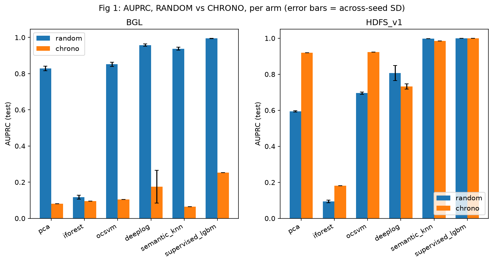
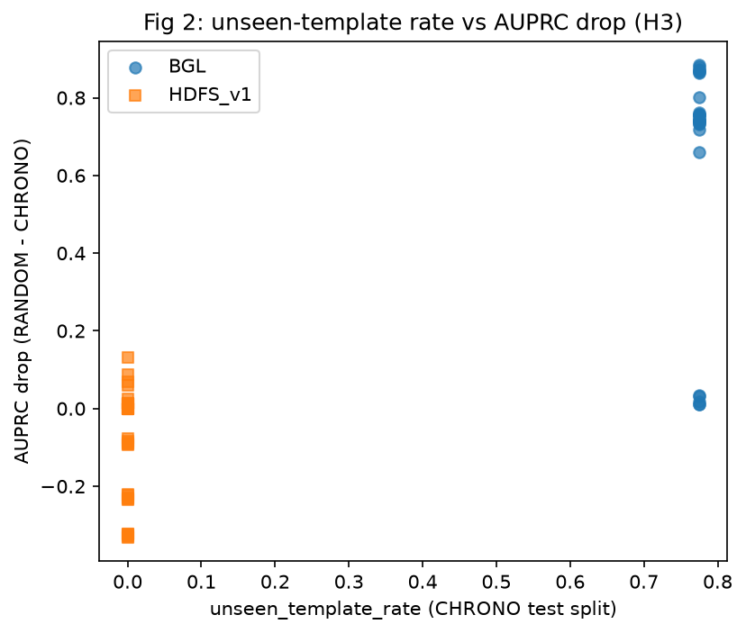

# loganomaly

Does log anomaly detection performance depend on how the data was split?

This project pre-registers and runs a benchmark comparing **random** 60/20/20 session splits against **chronological** splits (train on the past, test on the future) for log-based anomaly detection on two standard public datasets (HDFS_v1 and BGL, from Loghub), across six methods and five seeds. The full writeup is in [`paper/draft.md`](paper/draft.md); the pre-registered protocol is in [`PROTOCOL.md`](PROTOCOL.md); every methodological decision and deviation made during the run is logged in [`DECISIONS.md`](DECISIONS.md).

## Headline result

**Split inflation is dataset-dependent and tracks template drift, not a universal property of chronological evaluation.** Chronological splitting substantially lowers AUPRC and AUROC and reorders which method looks best **on BGL**, where 77% of chronological test-template occurrences are unseen in training -- but not **on HDFS_v1**, where the small, 55-template vocabulary is almost entirely covered within the first 60% of its timeline. HDFS_v1's apparent AUPRC *gains* under chronological splitting turn out, on closer inspection (AUROC, which is prevalence-invariant, stays nearly flat; a rolling-origin check at other cutoffs shows the result isn't stable), to be mostly a test-set-prevalence artifact rather than a real improvement. The AUPRC drop correlates strongly with unseen-template rate (Spearman rho = 0.80, p < 0.001) -- consistent with, though not conclusive proof of, the drift mechanism, given an effective sample size of 2 datasets. A post-hoc review found that one method (`deeplog`) had been scored with a heuristic that saturates on HDFS_v1's small vocabulary; it was corrected and all of its cells were re-run, and no hypothesis verdict changed as a result. See [`results/full/VERDICTS.md`](results/full/VERDICTS.md) for the pre-registered hypothesis verdicts, [`results/full/VERDICTS_v2.md`](results/full/VERDICTS_v2.md) for the verdicts recomputed after the correction, and [`paper/draft.md`](paper/draft.md) for the full analysis.

| Dataset | Split | AUPRC range across 6 arms | Mean unseen-template rate |
|---|---|---|---|
| HDFS_v1 | random | 0.09 - 1.00 | 0.0000 |
| HDFS_v1 | chrono | 0.18 - 1.00 | 0.0000 |
| BGL | random | 0.12 - 0.99 | 0.0004 |
| BGL | chrono | 0.06 - 0.25 | 0.7746 |

<!-- results/full/summary.csv, results/full/VERDICTS.md -->




## Reproduce in 5 commands

```
py -3.11 -m venv .venv && .venv\Scripts\activate && pip install -r requirements.txt
python scripts/download_data.py
python src/parse.py --dataset HDFS_v1 && python src/parse.py --dataset BGL && python src/sessionize.py --dataset HDFS_v1 && python src/sessionize.py --dataset BGL && python src/split.py --dataset HDFS_v1 --seeds 0 1 2 3 4 && python src/split.py --dataset BGL --seeds 0 1 2 3 4
python src/run_all.py
python src/analysis.py && python src/make_figures.py && python scripts/make_tables.py
```

See [`REPRODUCE.md`](REPRODUCE.md) for the full command list (including selftest mode) and measured runtimes on the machine this was run on.

## Data and licence

Both datasets are from [Loghub](https://github.com/logpai/loghub) (Zenodo record 8196385), free for research use with citation:

- Zhu et al., "Loghub: A Large Collection of System Log Datasets for AI-driven Log Analytics", ISSRE 2023.
- Jiang et al., "A Large-scale Evaluation for Log Parsing Techniques: How Far are We?" (Loghub-2.0), ISSTA 2024.

Raw and processed data are not committed to this repository (see `.gitignore`); `scripts/download_data.py` fetches them, and `data/raw/INVENTORY.md` documents their inspected format.

## Project layout

```
PROTOCOL.md         pre-registered hypotheses, metrics, decision rules (written before any experiment ran)
DECISIONS.md         every methodological decision/deviation made during the run, with reasons
src/                 pipeline: parse -> sessionize -> split -> features -> arms -> evaluate -> run_all -> analysis -> make_figures
scripts/              setup, data download, data stats, tables, robustness checks
results/full/         per-cell metrics, verdicts, figures-source data, run log, hardware info
figures/               the four pre-registered figures (PNG + PDF)
paper/                 draft.md, tables.md, references.bib
```

## Status

All 120 non-LLM experiment cells (2 datasets x 2 splits x 6 arms x 5 seeds) completed. The exploratory `llm_zeroshot` arm's main-run attempt (1.5B model) was marked SKIPPED after repeated, machine-specific GPU/memory failures (see `DECISIONS.md`, Step 04); a post-hoc analysis retry with a smaller 0.5B model completed successfully and is reported separately (`paper/draft.md` Section 5.7, `results/audit/llm_table.md`) -- sample-based, single-seed, with no pre-registered hypothesis. None of this affects the five pre-registered hypotheses, which are defined only over the six non-LLM arms. See [`SUMMARY.md`](SUMMARY.md) for the full outcome summary.

## Licence

Code and text in this repository are released under the [MIT licence](LICENSE); the datasets are licensed separately as described above.
